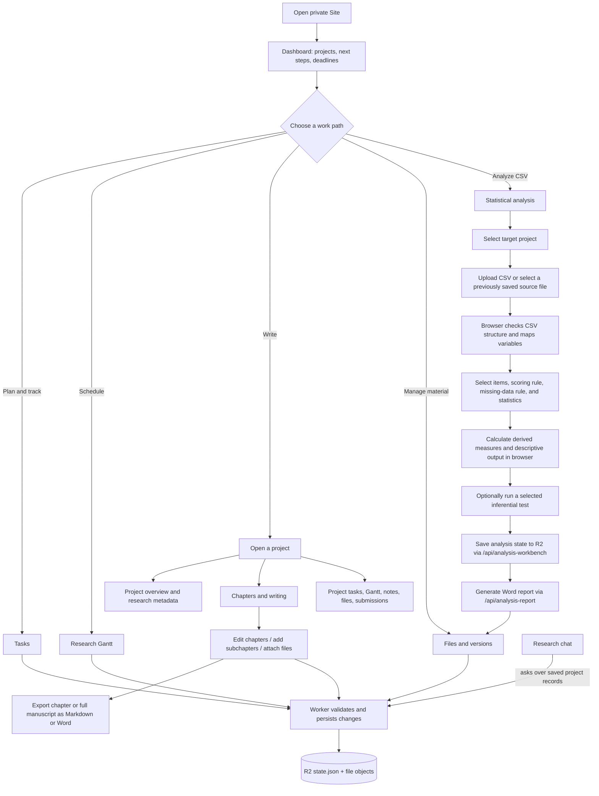
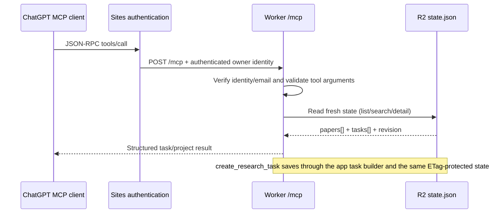
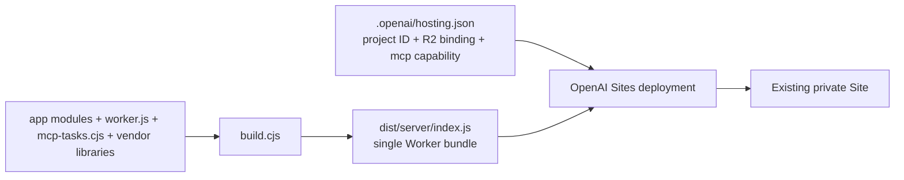

# מרחב המחקר — architecture, APIs, and platform workflow

This document describes the code and deployment configuration in this repository. It documents the existing application; it does not change the Site or its data.

## 1. What the project is

“מרחב המחקר” is a private, Hebrew-first research workspace. It is a single-page browser application served by a Cloudflare Worker through OpenAI Sites. The browser renders the interface and performs CSV parsing and statistical calculations. The Worker provides the app's internal REST API, stores shared application state and uploaded files in the bound R2 bucket, generates Word files, and serves the MCP endpoint for research-task tools.

The Site is configured with the existing project ID, R2 binding `BUCKET`, no D1 binding, and the `mcp` capability. Site audience enforcement happens before normal Worker requests are dispatched. MCP data calls add a second owner check using the authenticated Site identity and the configured owner email.

## 2. Architecture diagram

```mermaid
flowchart LR
    U[Owner in browser / ChatGPT] -->|private Site session| S[OpenAI Sites hosting]
    S -->|serves app shell| W[Cloudflare Worker<br/>dist/server/index.js]
    S -->|authenticated dispatch| M[POST /mcp<br/>JSON-RPC + MCP tools]
    W -->|HTML + bundled JS| B[Browser SPA<br/>app/index.html]
    B -->|same-origin REST /api/*| S
    S --> W
    W -->|state.json<br/>ETag conditional writes| R2[(Cloudflare R2<br/>BUCKET)]
    W -->|files/{id}, chats/{id}| R2
    B -->|CSV parse, map, descriptive + inferential calculations| C[Browser analysis engine<br/>analysis-workbench.js]
    C -->|save mapping, measures, results| W
    W -->|Word report generation| D[DOCX/report modules<br/>word.cjs + analysis-report.cjs]
    D --> R2
    M -->|fresh state read / atomic task write| R2
    M -->|verified owner identity| I[Site identity headers<br/>MCP_OWNER_EMAIL check]
```

### Main layers

| Layer | Responsibility | Main implementation |
|---|---|---|
| Site hosting | Keeps the existing Site identity and owner-only audience; dispatches the Worker | `.openai/hosting.json` |
| Build | Inlines the app, analysis module, helper modules, DOCX/ZIP libraries, MCP adapter, and Worker into one deployable Worker bundle | `build.cjs` |
| User interface | Navigation, dashboard, project pages, tasks, Gantt, files, activity, backup, and statistical analysis screen | `app/index.html`, `app/analysis-workbench.js` |
| API/runtime | Routes same-origin `/api/*` and `/mcp`; validates inputs and coordinates persistence | `worker.js`, `mcp-tasks.cjs` |
| Shared state | One JSON state object with project/task/chapter/file metadata and analysis records | R2 object `state.json` |
| Binary files | Uploaded source files, generated chapter exports, and analysis reports | R2 objects `files/{id}` (or a stored `cloudKey`) |
| Conversations | Research chat messages kept separately by project | R2 objects under `chats/` |
| Statistical computation | CSV decoding, variable mapping, derived measures, summaries, and selected tests run in the browser | `app/analysis-workbench.js` and its `StatisticsEngine` |
| Word output | Builds a DOCX report from the submitted calculated results and saves it as a normal project file | `app/analysis-report.cjs`, `app/word.cjs` |

There is no D1 database configured for the Site deployment. The live Worker reads the same R2 `state.json` for the web application and MCP. The local development server is a separate mode and uses local SQLite and filesystem storage; it is not the live Site's persistence layer.

## 3. How the platform workflow works



### Typical user journeys

1. **Start at the dashboard.** The dashboard is the overview: open a project, see upcoming/late work, add a project or task, and use the main navigation to enter a dedicated workspace.
2. **Work within a project.** A project page groups overview, chapters, tasks, Gantt, notes/decisions, files, and submissions. Records have a project ID, so the app can filter and link related material.
3. **Write and export.** Edit chapter content and optional subchapters; attach supporting files to chapters; export a chapter or the full manuscript as Markdown or DOCX. Generated exports are added to Files and versions.
4. **Analyze a dataset.** Choose the project and CSV. The browser reads the CSV, detects its structure and candidate values, and displays the variable mapping. The researcher decides which columns and items form measures and confirms scoring/missing-data rules before calculation. The browser creates descriptive summaries and only the inferential procedure explicitly selected by the user.
5. **Keep and report results.** The browser sends the analysis configuration/results to `/api/analysis-workbench`, where the Worker stores them in that project's state. For a Word report, it sends the selected project, source-file ID, measures, tables, and inference history to `/api/analysis-report`; the Worker generates a DOCX, stores it in R2, adds a file record, and returns its file ID for download.
6. **Use task tools from ChatGPT.** The MCP endpoint reads the same current `state.json`. Task listing/search is read-only. Task creation is available only on explicit request, requires an existing project ID, checks owner identity, and uses an idempotency key so retrying does not duplicate a task.

### Analysis data flow, with trust boundaries

- A CSV is uploaded through `/api/upload` and stored as an opaque file object. The original source is retained; statistical parsing/calculation happens in the browser.
- The browser builds a source fingerprint from file name, size, and bytes to associate mapping/measures/results with the selected saved file. Analysis records also store `paperId` and `fileId`.
- `/api/analysis-workbench` saves the mapping, measure definitions and scores, selected output tables, inferential configuration/result/history, editable paragraphs, and selected result view in `state.json` (`analyses[]`). It does not rerun the statistics server-side.
- `/api/analysis-report` checks that the selected project and source file exist, assembles a DOCX from the payload and authoritative project title/file name, saves that report in R2, and adds a `files[]` record.
- Do not interpret statistical output as causal evidence. The interface includes method assumptions/cautions; analysis choice and interpretation remain the researcher's responsibility.

## 4. REST API map

All routes below are same-origin routes handled by `worker.js`. On the live Site, OpenAI Sites enforces the configured private audience before dispatch. JSON responses are `no-store`. The browser uses these routes; MCP is a separate JSON-RPC endpoint.

| Method and path | Purpose | Important behavior |
|---|---|---|
| `GET /api/health` | Runtime/storage health | Returns availability and `R2` storage status. |
| `GET /api/state` | Load the application state | Reads current `state.json`; includes the current revision. |
| `POST /api/state` | Persist a validated full state update | Requires the client's revision to match; protects file metadata from being overwritten via generic state save; uses R2 ETag conditional write. |
| `POST /api/workspace` | Apply a workspace action | Delegates action validation/mutation to `workspace-actions.cjs`, then persists state. |
| `POST /api/save-record` | Save one record by kind | Uses `record-saving.cjs`; supports projects, chapters, tasks, notes, tools, sources, opportunities, submissions, requirements, and analyses. Merges against a baseline to avoid overwriting concurrent edits. |
| `POST /api/draft` | Save/update a keyed draft | Upserts the draft in `drafts[]`. |
| `POST /api/upload` | Upload a file/folder entry | Stores file bytes under a generated object key; validates project/chapter link and a 50 MB per-file limit; adds file metadata to state. |
| `GET /api/file/{id}` | Download a stored file | Resolves the file metadata and returns the R2 object as a private, no-store download. |
| `POST /api/reassign-file` | Change project/chapter/category assignment | Validates the project and chapter relationship, then updates metadata. |
| `GET /api/chat?paperId={id}` | Read chat history for a project | Reads that project's separate chat object. |
| `POST /api/chat` | Ask a question about saved research records | Calls the local `research-chat.cjs` record-based answerer and stores the conversation. It searches structured project/task/chapter/file records; it does not analyze the contents of uploaded files. |
| `POST /api/analysis-workbench` | Save the user's analysis setup and results | Checks the saved file/project and input shape; upserts one analysis record per source file. |
| `POST /api/analysis-report` | Generate and save a statistical DOCX report | Requires an existing source file, project, and at least one measure; report is then accessible through `GET /api/file/{id}` and Files and versions. |
| `POST /api/export-writing` | Export one chapter or the full manuscript | Supports Markdown and DOCX; generated output is saved and returned with updated state. |
| `POST /api/session` | End a writing session/export updated content | Creates Word versions for changed chapters plus a full manuscript, and records them as generated files. |
| `GET /api/backup?paperId={optional}` | Download an all-project or one-project backup | Produces a ZIP containing state, a manifest, file objects, and chat history. A `paperId` scopes the backup. |
| `POST /api/restore` | Restore a backup | Validates ZIP entries and sizes, stages objects, creates a safety snapshot, and merges project-scoped backups or restores a full backup. |

### Migration/compatibility routes

These exist for migration, not normal day-to-day usage: `GET /api/migration/status`, `POST /api/migration/file?id=…`, `POST /api/migration/state`, and `POST /api/import-legacy`. They should not be treated as public import APIs; they are governed by the same private Site dispatch and validate whether initial migration is allowed.

## 5. MCP API map (ChatGPT task integration)

The MCP server is `POST /mcp` (stateless JSON-RPC, protocol version declared in `mcp-tasks.cjs`). Discovery can expose schemas, but calls that read or create records require both a Sites-authenticated user ID and a verified email matching the runtime `MCP_OWNER_EMAIL`. Missing identity or a non-owner fails closed.



### Exposed tools

| Tool | Access | What it does |
|---|---|---|
| `list_research_projects` | Read | Returns current project IDs, names, and codes. |
| `list_research_tasks` | Read | Lists current tasks; filters include project ID/name, status, priority, exact/ranged due dates, dated/undated, and pagination. |
| `search_research_tasks` | Read | Searches task title, description, and project name, with the same filters. All query terms must match. |
| `get_research_task` | Read | Reads a task by exact ID. |
| `create_research_task` | Write, explicit request only | Creates a task only on an explicit user request, for an existing project. It accepts title, description, due date, priority, initial status, and required idempotency key. It returns the persisted task. No edit/delete tool is exposed. |

Task output contains ID, title, project ID/name, due date, priority, status, description where available, and other available scheduling metadata. Create retries with the same key and same normalized payload replay the original record; reusing the key with changed inputs is rejected. The create receipt and task are saved together in the same state object.

## 6. Build and deployment



`build.cjs` reads the app and helper modules, embeds the HTML and analysis script, includes vendor DOCX/ZIP libraries, bundles the MCP adapter and Worker, then copies the hosting manifest. `.openai/hosting.json` points at the existing Site project ID and R2 binding and declares the MCP capability. The manifest currently has no D1 binding. This architecture document does not publish or alter the Site.

## 7. Source map

- `app/index.html` — app shell, navigation, project/task/file views, forms, and dashboard.
- `app/analysis-workbench.js` — CSV analysis workflow, in-browser calculations, persistence requests, charts/tables, and report request construction.
- `worker.js` — live API routes, R2 state/file access, concurrency checks, backup/restore, report/export orchestration, and MCP route dispatch.
- `mcp-tasks.cjs` — MCP discovery, schemas, task filters/search/details, owner enforcement, idempotent task creation.
- `app/record-saving.cjs` and `app/workspace-actions.cjs` — record-level saves and workspace actions.
- `app/research-chat.cjs` — deterministic answers assembled from saved project/task/chapter/file metadata.
- `app/analysis-report.cjs` and `app/word.cjs` — DOCX report and writing exports.
- `build.cjs` — deployment bundle assembly.
- `.openai/hosting.json` — Site project ID, storage binding, and capabilities.

## 8. Operational notes and boundaries

- The web app, MCP task tools, and statistical analysis use different interfaces but share the same private R2-backed research records where applicable.
- Statistical calculations run in the browser after the user selects and confirms inputs; the Worker persists their configuration/results and generates the Word report. The Worker does not silently choose/recalculate a statistical model.
- Uploaded source data is stored as a file object; the analysis UI reads CSV locally in the browser. The existing research chat is record-aware but explicitly does not parse uploaded file contents.
- ETag/revision checks prevent concurrent full-state writes from silently overwriting another window's newer state.
- The Site's private audience is a hosting boundary. The MCP tool adapter additionally checks owner identity for record operations. The browser REST routes rely on the Sites dispatch/audience boundary rather than implementing a separate login/session system inside `worker.js`.
- The local `app/server.cjs` is a development/local mode using SQLite and a local filesystem. Its persistence and local-only guard are not the production Sites Worker architecture described above.
